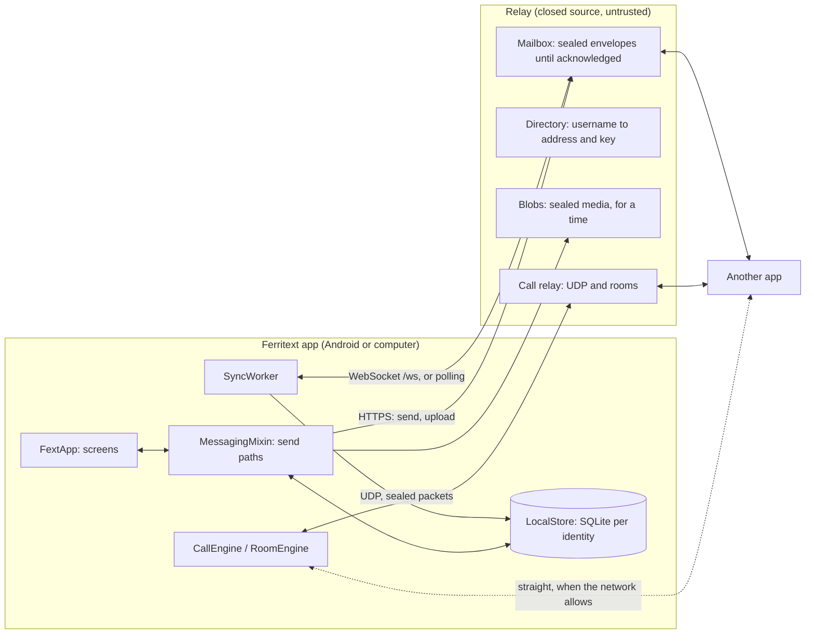
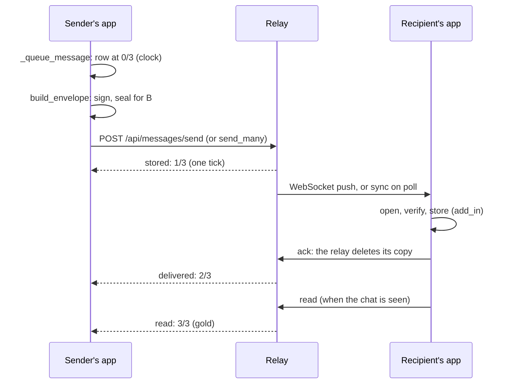
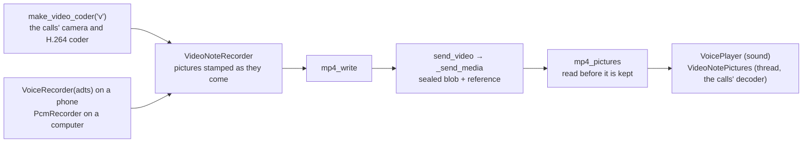

# Ferritext client: architecture

This document is the starting point for anyone, a developer or an AI
agent, who has to understand the Ferritext app well enough to change it.
It covers how the parts fit together and why. It does not say what each
line does: the code says that, and its docstrings explain the reasons.
For what the app does for its users, see the [README](README.md).

Keep it current. A change that moves a boundary described here (a new
thread, table, wire field, relay call or screen family) updates this file
in the same commit. Symbols are named rather than given by line number, so
`grep -n "def name" main.py` finds them.

Contents: [1 Principles](#1-principles) ·
[2 The system](#2-the-system) · [3 The repository](#3-the-repository) ·
[4 main.py's layers](#4-mainpys-layers) · [5 Threads](#5-threads) ·
[6 Identity and keys](#6-identity-and-keys) ·
[7 A message, end to end](#7-a-message-end-to-end) ·
[8 Groups](#8-groups) · [9 Media](#9-media) · [10 Calls](#10-calls) ·
[11 Local storage](#11-local-storage) ·
[12 The relay, as the app sees it](#12-the-relay-as-the-app-sees-it) ·
[13 Screens, themes, languages](#13-screens-themes-languages) ·
[14 Platforms](#14-platforms) · [15 Compatibility](#15-compatibility) ·
[16 Tests and tools](#16-tests-and-tools) · [17 Releases](#17-releases) ·
[18 Where to change what](#18-where-to-change-what) ·
[19 Glossary](#19-glossary)

## 1. Principles

- **The relay is untrusted.** Every message is sealed on the sender's
  device for one recipient and signed by its author. The relay stores and
  forwards ciphertext, keeps a public directory of usernames and addresses,
  and relays calls. A malicious relay cannot read, forge or silently change
  a message. The relay is a separate, closed-source program; this document
  describes only what the app sees of it (§12).
- **One file.** The whole app is `main.py`, on Android and on computers.
  A reviewer can audit it top to bottom, and the desktop build is that same
  file with its assets appended (§14).
- **Additive compatibility.** Each release talks to every earlier release
  still in use and opens every earlier database. Wire fields and database
  columns are only ever added, each with a safe default (§15).
- **One rule for threads.** Only the UI thread touches widgets. Every
  other thread talks to it through `ui_queue` or `run_on_ui` (§5).
- **Custody before acknowledgement.** The app acknowledges a message to
  the relay, which then deletes its copy, only once the plaintext is
  stored on the device (`SyncWorker._ingest_message`).
- **No technical debt for speed.** Measure before optimising
  (`desktop/bench.py`), and keep what a junior developer can read.

## 2. The system

On Android a background service (`run_background_service`, with
`HeadlessApp`) keeps the same `SyncWorker` running while the app is
closed, so messages arrive and notifications show.

## 3. The repository

| Path | What it is |
| --- | --- |
| `main.py` | The app: every layer of §4 |
| `android/*.java` | What Python cannot do well on Android: call audio (`CallAudio`), the camera and video codecs (`VideoCall`), notifications (`Notifier`, `NotifyReceiver`), QR reading (`QrReader`); and Android's resources |
| `buildozer.spec`, `recipes/`, `tools/p4a_hook.py` | The Android build: python-for-android, the libopus recipe, the manifest additions |
| `data/` | The mark, icons, bundled fonts (`data/fonts/`) and language packs (`data/lang/`) |
| `desktop/` | Every test suite (§16), the screenshot tool `capture.py`, the benchmark `bench.py`, and the desktop build's files |
| `tools/` | Builders and checkers: fonts, logo, phrases, the desktop bundle, the download page, the device tests (`tools/devices/`), the dependency audit |
| `.github/workflows/` | CI: the APK and the Windows EXE, the next Android platform (`apk-next`), the device tests (`devices`) |
| `README.md`, `CREDITS.md` | For users; the open-source work the app uses and its licences |

## 4. main.py's layers

The file runs top to bottom in layers; each uses only those above it.
Everything above the widget kit imports without a window
(`KIVY_WINDOW=none`), which is what the Android service and the test
suites rely on.

| Layer | Its parts |
| --- | --- |
| Crypto core | secp256k1, Base58Check, RFC 6979 signatures, ECDH; ML-KEM-768 (post-quantum, pure Python) |
| Configuration | `APP_VERSION`, feature bits (`FEATURES`), limits |
| Languages | `tr`, `trn`, `N_`; `pick_language`; `date_text` |
| Design system | `THEMES`, `THEME_SETS`, text size, motion, fonts, script faces, line breaking, right-to-left order |
| Utilities and sanitisers | `sanitize_*` for every field a peer sends; links, timers, mentions, backups |
| `MessageFlowLog` | The audit trail of every message's ticks (`fext.flow` log) |
| Platform glue | Android through pyjnius; desktop fallbacks; notifications; file dialogs |
| Calls | Codecs (Opus, ADPCM, video through PyAV or Android's codecs), `CallKeys`, the jitter buffer, `CallEngine`; `CallSession` (the state every call screen draws); `RoomCall`, `RoomEngine` (group calls) |
| Identity and network | `IdentityManager`, `CryptoEngine`, `ApiClient` |
| Storage | `LocalStore` |
| Sync | `SyncWorker`: the WebSocket, polling, receiving, controls |
| Widget kit | `Btn`, `ListRow`, `ToggleSwitch`, `Segmented`, `Sheet`, `MenuSheet`, `PageScreen`, … |
| Screens | the chat list, the conversation, info pages, settings, call screens |
| `MessagingMixin` | The send paths, shared by the app and the background service |
| `FextApp` | The Kivy application: navigation, actions, the UI queue |
| `HeadlessApp` | The Android background service |

## 5. Threads

| Thread | What it does |
| --- | --- |
| UI (Kivy main loop) | Every widget. Nothing else may touch one |
| `SyncWorker` (one per active identity) | The socket or polling; opening, storing and acknowledging; raising notifications; housekeeping every few seconds (`_chores`) |
| Short-lived workers | Each send, upload, download, group publication, call set-up, backup |
| `CallEngine` / `RoomEngine` | One per call: its socket, codec and jitter buffer, on a 5 to 20 ms tick |
| Audio and camera | Java threads on Android; sounddevice callbacks on computers |
| Video (`VideoSender`, `VideoReceiver`; a video message's `VideoNoteRecorder` and `VideoNotePictures`) | Coding and decoding pictures, so the UI only draws the newest one |

Workers reach the UI only through `ui_queue` (drained by
`FextApp._drain_ui_queue`) or `run_on_ui`. The queue is a `WakingQueue`
(18.2): an event put on it asks for the next frame, so a message that
arrives alone is shown at once; events that follow within `UI_TICK` are
taken together, so a backlog stays one repaint a tick. `LocalStore` is
lock-protected and safe from any thread. On Android a thread that used
Java ends with `leave_jvm()`, and the app's own Java classes are found
on the UI thread first (`android_find_call_classes`).

**The garbage collector (18.2).** Python's long look at every object the
app holds took 80 to 400 ms and fell where a person had just asked for
something. `QuietCollector` sets start-up's objects aside (`gc.freeze`),
stops the automatic long look, and takes it itself at a quiet moment:
three seconds without a touch or a key, nothing sounding
(`FextApp.sounding`), at most every 30 s; a deeper one when owed (after a
theme's rebuild, every ten minutes of use, when the app leaves the
screen). What a theme's rebuild itself made is looked through a tenth
of a second after the theme shows, while the screen is still
(`_collect_after_rebuild`). `desktop/playthrough.py` shows the
collector's share of each step.

## 6. Identity and keys

- An identity is a secp256k1 key. Its address is a Base58Check
  (Bitcoin-style P2PKH) address, mined until it starts with `Fec`
  (`mine_identity`). The relay checks that work when someone registers.
- A username is registered with the relay by signing `register.<name>`.
  The relay's directory maps it to the address and public key.
- Every identity also has an ML-KEM-768 key (seeded from `pq_seed_hex`).
  Contacts learn it from the `x.pq`/`x.pqe` fields of signed messages, and
  from then on messages to them are sealed with both keys (§7).
- One device may hold several identities (`IdentityManager`). Each has its
  own database, and only the active one syncs; 17.2 lets the others ring.
- Keys live in `identities.json` in the data folder; backups
  (`make_backup`, `restore_backup`) carry them, sealed by a passphrase.
- **The key for another device (18.2).** `device_key_text` is both keys
  as one text (`fextkey1` and a Base58Check of the private key and the
  ML-KEM seed), copied or shown as a code in My profile;
  `parse_identity_key` reads it, a WIF or hex, and
  `IdentityManager.add_identity` keeps the seed. A WIF alone still
  brings a new ML-KEM key (§15).

## 7. A message, end to end

- **The envelope** is `{ephemeral_public_key, nonce, ciphertext}`:
  AES-256-GCM under a key from ECDH with the recipient's key, and, once
  their ML-KEM key is known, an ML-KEM secret mixed in (`PQ_MAGIC`).
- **Inside** is the readable `body` (what the oldest apps show), the
  sender's identity, an ECDSA `signature`, and the **x-block**: everything
  newer (kind, recipient, client id, reply, media, group, timer, link
  preview, controls…), signed separately (`xsig`). `sanitize_ext` checks
  every x field on arrival; anything unknown is dropped.
- **Controls** are x-blocks of kind `ctl`: delete, edit, react, group
  state, leave, pictures, timers, call signals, and more. They are acted on
  and acknowledged, never shown (`SyncWorker._handle_control`).
- **Order** (18.0.1): the relay numbers what comes as it comes, and the
  other side shows and applies it in that order. So what a chat sends (a
  message's first try, an edit, a reaction, a delete) goes on a thread
  that waits for the chat's send begun before it (`_in_chat_order`);
  chats do not wait for each other. Pictures and voice notes go when
  their upload ends.
- **The outbox**: a message the relay did not take stays at 0/3 and
  `flush_outbox` sends it later, oldest first, leaving a chat alone while
  its sends go. A message the relay's operator (17.3) or the group's
  admin (17.4) stopped waits until the stop ends.
- **Receiving** (`SyncWorker._ingest_message`): a blocked sender's frames
  are held sealed until unblocked; a stranger's first message waits under
  Message requests with receipts off; everything else is opened, checked,
  stored, acknowledged, then notified.
- **What arrives malformed (18.1).** A sealed message that will not open
  is retried a few times, then recorded as unreadable and acknowledged
  (`_handle_undecryptable`). One that opens can still be wrong: not a
  JSON object, text that no database stores (half of a surrogate pair),
  a field of the wrong kind. `open_envelope` refuses those as it does
  one that will not open, each `sanitize_*` returns its empty value
  for anything that is not what it expects, and `_ingest_message` is a
  net around the rest (`_ingest`): whatever is raised there is handled
  as an unreadable message, never raised into the session. Before 18.1
  such a message ended the session unsaid, the relay sent it again on
  each reconnect, and the mailbox stopped behind it. A control that
  cannot be followed is acknowledged at once. `assert` guards nothing:
  python-for-android compiles the app without them.
- **Away replies** (18.1): after a message that would notify, the worker
  asks `MessagingMixin.away_reply`, in the app and in the background
  service alike. With *Settings › Away* on (prefs `away_since`,
  `away_text`), a chat with one accepted person is answered with the
  user's words through `send_text(auto=True)`: an ordinary sealed message
  whose x-block carries `auto: 1`, shown as *Automatic reply*. One a chat
  every `AWAY_EVERY` (`contacts.away_at`), and none to a message that
  carries `auto`, so two away devices stop after one each. The relay has
  no part in it.

## 8. Groups

The relay never knows a group exists. A group is a list of members that
each member's app keeps, and a group message is one ordinary 1-to-1
envelope per member, carrying `x.grp = {id, v}`.

- **State**: `{id, name, v, admin, members: [{a, k, u}], r, tp, ad, lg}`.
  `admin` is the owner. An admin changes it: their app bumps `v` at once
  (`_commit_group`) and sends the whole state to every member
  (`_publish_group_state`, control `group`). Each member's address must
  be the hash of the key given for it (`sanitize_group_state`).
- **Admins (18.0)**: `ad` holds the other admins, `{address: {"r":
  [rights], "by"}}` (`ADMIN_RIGHTS`: info, add, remove, rules, topics,
  delete, admins). An app adopts a state from any admin of the state it
  holds, with a higher `v` (`state_wins`), whose rights cover every change
  in it (`admin_change_allowed`: never the owner, admins only of their own
  making). Two admins at the same `v` are settled alike on every phone:
  the owner's, else the lower address's. `lg` is the admin log, the last
  `ADMIN_LOG_MAX` (50) entries `{v, a, e, t, at}`; each app keeps the
  entries of the admin whose state it took (`_log_more`).
- **Apps before 18.0** follow the owner alone. When the owner's app takes
  another admin's state it sends it on to them as it is, without `lg` and
  marked `fw` (`forward_group_state`; 18.0 apps leave a `fw` copy, having
  the admin's own). A state that wins at the version held (a tie) is
  published again by the owner at the next one, as an older app may hold
  the other.
- **Leaving**: control `leave`. If the owner leaves, every app picks the
  same new owner: the first other admin in the members' order, else the
  first member (`_apply_leave`). When that is not the first member, the
  owner's app first sends the state that names them (`_handover`), so
  apps before 18.0 (which take the first member) agree.
- **Joining by a link (18.0)**: a link for anyone (`fx2.`, `join_link`,
  `parse_join_link`) names its maker, a random id, the group or call, and a
  name; no key and no token. Opening it sends the maker a sealed `knock`
  (an upkeep control, not a message request), as the identity chosen
  (`AskToJoinSheet`). The maker's app keeps it while the link is open
  (`join_links`, `join_asks`) and their answer is an `admit`: a call's
  invite, or the group's invitation (`add_group_members`), or no. The
  asker's app keeps what it asked (`join_asked`) and takes an `admit`
  only from that link's maker: the link is anyone's to read.
- **Fan-out**: one sealed copy per member, in `send_many` batches where
  the relay offers it. `group_sends` tracks each member's ticks.
- **What members may do (17.4)**: defaults for every member, and a
  restriction on one. The state's `r` holds the admin's rules:
  `{"deny": {right: since}, "lim": {address: {"deny": [rights], "at",
  "until"}}}`. The rights are `send` (messages), `media` (photos and
  voice messages, also stopped by `send`) and `calls` (starting a call).
  Joining a call, reacting and deleting one's own messages are never
  stopped, and the admin never is. Times are the relay's clock
  (`ApiClient.relay_now`), so every member's app agrees on them.
  - The member's own app does not send what the rules stop
    (`MessagingMixin.group_rule`, `group_stop`). The composer gives way to
    a note saying until when; the outbox waits.
  - Every receiver holds anything that is sent anyway (by an app older
    than 17.4, or one that has not yet heard), judged by when the relay
    took it (`SyncWorker._group_held`, `group_denied`). A message the relay
    took before a stop still arrives.
  - A restricted member is told in their chat; nobody else is.
  - Rules are stored with the state's version (`groups.rules`). A newer
    state without `r` (an admin's app older than 17.4) clears them.
- **Topics (17.4)**: the state's `tp` is `{"on", "list":
  [{"id", "n", "c"}]}` (8-hex ids, names, closed), set by the admin
  (`FextApp.change_topics`). A message names its topic in `x.tp` (kept in
  its `ext`); one without is in General.
  - The chat filters as it draws (`ConversationScreen.in_topic`, called by
    `refresh_chat` and `_extend_history`). The store and the chat's
    windows are as for any chat; a new topic redraws the chat from its end
    (`reset_chat_window`).
  - Under *All*, a bubble names its message's topic beside its author
    (`topic_label`), and runs of messages break at a topic
    (`same_run`). A message goes to the topic shown, or to its
    original's topic for a reply (`compose_topic`). A closed topic takes
    the admin's messages alone (`topic_closed`).
  - The chat marks read only what it shows (`mark_peer_read(shown=True)`):
    another topic's messages stay unread, a dot on its chip
    (`unread_topics`). A chat opens on *All*, so opening reads them all.
  - Off keeps everything: the list stays in the state, the messages keep
    their `tp`, and *All* names their topics. On again, each topic is back.
  - Stored with the state's version (`groups.topics`), as the rules are.
    Older apps ignore `tp`: one chat, writing to General.
- **Limits**: `MAX_GROUP_MEMBERS` (32), because each message is sealed
  once per member; `MAX_TOPICS` (32).

## 9. Media

Photos and voice messages are sealed on the device with a fresh key,
uploaded as a blob (`/api/blobs`), and sent as a reference
(`x.media = {blob, key, sha, mime, size, …}`) inside a message, so a
group shares one upload. The relay keeps blobs for a limited time. A
member who comes back too late asks the author to upload again (control
`resend`, answered by `remedia`). Profile and group pictures are small
enough to travel inside a control (`pic`, `gpic`), so they never expire.

**Video messages (18.1)** are a third kind of media (`kind: "video"`,
`video/mp4`, at most a minute, under the same 8 MB). What is new is the
file, and it is made in one place for every platform:

- `mp4_write` and `mp4_read` are plain Python: H.264 and AAC, `moov`
  before `mdat`, one sample a chunk, no B-pictures. Their helpers:
  `annexb_nals` (a coder's picture cut into NAL units), `sps_size` (the
  picture's size, from its parameter set), `adts_frames` (a phone's
  sound) and `aac_frames` (a computer's, through PyAV). A phone and a
  computer therefore make the same file, and what a phone runs is
  checked on a computer (`desktop/test_videomsg.py`).
- The recorder keeps pictures from the first key picture on and asks for
  one every two seconds (where playing can start from). The sound starts
  first; what was heard before the first picture is cut off when the
  file is written. It ends by itself at a minute, near the size limit
  (`media_limit`: the app's, or the relay's where it takes less, which
  also shortens the minute), or when the camera fails or hands over
  nothing for `VIDEO_NOTE_QUIET` seconds (Android does not always say
  that another app took it).
- Nothing is recorded unseen: `VideoNoteSheet.stop_here` stops the
  recording where it is, letting the camera and the microphone go, when
  the app leaves the screen (`on_pause`) or a call begins on this device
  (`_call_begins`: it rings, is placed or joined; a message that was
  playing stops too). What was recorded waits for Send or Delete. Once
  it records, the sheet closes only by those two. A voice message being
  recorded is paused then, hands-free
  (`ConversationScreen.hold_for_call`), so it is never sent by itself
  at its limit; where it cannot pause (Android 6) it is deleted.
- Playing: the sound through `VoicePlayer` (the MP4 itself, at 1×); the
  pictures on a thread, each decoded when the sound's position reaches
  it, skipping to the next key picture when late. The sound never waits.
- An app before 18.1 drops a media reference of a kind it does not know
  and shows `body` ("Video message (0:42)"); `FEATURE_VIDEO` /
  `CAP_VIDEO` tell the sender who can play one.

## 10. Calls

**1-to-1 calls.** The signals (`call`, `ringing`, `answer`, `cands`,
`end`) are controls inside ordinary sealed messages. Each side's
`CallEngine` thread owns one UDP socket from the first ring, so a way is
known by the time the call is answered. It tries every way to the other
device at once (straight, through the relay's UDP port with a ticket from
`/api/calls/ticket`, or over the WebSocket) and sends each packet the best
way heard from in the last few seconds. Packets are sealed with the call's
keys (`CallKeys`). Sound is Opus (48 kHz where both offer `opus48`,
adapting its packet length and bitrate) or ADPCM for old apps. Video is
AV1, HEVC or H.264, the best both sides decode (`VIDEO_CODECS`): PyAV on
computers, MediaCodec on Android (`VideoCall.java`).

**A call that cannot ring yet (18.1).** Someone who has not accepted a
chat request, nor written, cannot be called: their app's abilities are
not known, and a stranger's call never rings. The caller's app says so
to them instead (`_call_as_request`: the control `called`, once a
minute), and their app shows a missed call's card in the chat
(`SyncWorker._called`), under Message requests while the request waits.
A call's own offer from someone not yet accepted is shown the same way.

**One identity on several devices (18.1).** The relay hands what is sent
to an address to every device connected as it, so a call rings on each.
The caller's app takes the key, codecs and addresses of the device that
answers (each rings with a key of its own), and tells them all which it
was, or that one declined (`_tell_taken`: the control `taken`, with the
answering device's call key or none). The others stop ringing, with a
card that says *Answered on another device* or *Declined call*, and say
nothing more to the caller (`_call_taken`). Once a call is answered, an
`end` that says it timed out, was declined or found them busy is
another of their devices, left ringing by an app before 18.1, and is
ignored (`CALL_UNANSWERED_REASONS`). Messages: every connected device
receives each one, and the first acknowledgement removes it from the
relay, so a device that was off has not got it; what a device sends is
not copied to the others. An identity restored from a backup brings its
post-quantum key with it; one added by typing its private key gets a
new one, and then only the device heard from last opens what is sealed
to it. One device at a time is still the rule; a second is best set up
from a backup.

**A phone's camera, which way up (18.1).** Android hands each picture
over with a matrix that already turns it upright for the phone's natural
way up and mirrors the front camera's. `VideoCall.java` turns the
picture sent only by how the phone is held (its orientation sensor,
`hold`; the coders are made again when upright becomes lying), with the
mirroring taken out; this phone's own tile keeps the mirroring. A video
message keeps the way up it began with (`follow(false)`).

**Delay on a phone (18.1).** Sound: the speaker (`CallAudio.speaker`)
is asked for Android's low-latency path and holds 40 ms of sound, not
all it can; `tune` gives it 10 ms more when it runs dry twice in a
second. Pictures: a phone asks for and draws a camera at 360 lines
unless Settings › Calls › Picture size on this phone says 480 or 720
(`video_box`, `phone_picture`, `PHONE_PICTURES`), and a picture that is
`VIDEO_LATE` behind when its turn comes is decoded and not drawn
(`VideoReceiver._decode`): a device that falls behind shows fewer
pictures, never older ones. The decoder is asked not to hold pictures
back where it says it can (`VideoCall.Decoder.started`: one asked for
what it cannot do refuses to start, so it is made again without), and
is asked again at once for the one it was just given.

**A call's pictures on a phone (18.2).** A call's decoder
(`android_call_decoder`) hands each picture over as its own rows, I420
(`VideoCall.Decoder.planes`, `i420`: the crop alone, thinned by whole
steps when the tile is much smaller), not as RGBA text. `YuvPicture`
keeps them in one texture, Y over U beside V, and the graphics chip
makes the colours and the size (`YUV_SHADER`, BT.601, in an `Fbo`); a
tile shows that texture as any other (`CallVideo._draw_rows`). A chip
that refuses the shader is logged once and the call goes back to text
(`YuvPicture.usable`). A video message's player keeps the text path. The
emulators' self-test draws red over blue this way and reads it back
(`video-draw`), and times a picture both ways.

**The meter (18.2)** also says what this device did with what arrived:
sound waiting to be played (`JitterBuffer.held_ms`), a phone's speaker
in its own account (`CallAudio.facts`), pictures too late to draw
(`VideoReceiver.late`); `meter_lines` puts them in words.

**Where a device is (18.1).** A straight way shows each device the
other's network address, which says roughly where it is.
`CallEngine.direct_allowed` is the rule: not while the call rings
unanswered on this device (the engine is made `unanswered`, until
`answered()`), and never with *Hide my location in calls* on
(`calls_hidden`). While it is false the engine offers no address
(`candidates`), sends nothing straight (`_emit`) and takes packets only
from the relay (`_drain_udp`). So `ringing` carries no address and
`answer` does; apps before 18.1 read them from either. The relay needs
nothing new: it forwards a call's packets as they are, and tells a device
only its own address.

**One thread owns a call's sound.** The app's threads never change an
engine's state beside it: they hand it a step (`set_mic`, `start_audio`,
`set_keys`), which the engine's own thread runs in order. 18.1 closed
the one place that did not: an answer given while the call was still
being prepared (`_prepare_incoming`, on another thread) set `muted`
directly, and could leave the microphone marked open and never
captured, so the caller heard nothing and the call never began. The
lobby's choice now goes through `set_mic`, and `_start_audio` reads
`muted` once.

**A call's first seconds (18.1).** As a ringing phone gives no address,
the sound starts through the relay and goes straight about 0.2 s after
the answer; the relay's extra delay is then in the jitter buffer
(`JitterBuffer`). It gives delay back by skipping a frame: once a second
while the sound goes on, and at every frame while the frame just played
is a pause (quieter than `CALL_QUIET_LEVEL`), where no one hears it,
never below its aim and two frames. A frame is a packet, 20 ms at first
and 5 ms within about 6 s (`_adapt`), so the packet length sets most of
what is left. Through a relay 150 ms further away, speech is at its least
delay about 9 s after the answer (13 with a skip a second only). Finding
the way while it rings would be quicker, but would tell the caller where
the one called is.

**Group calls (rooms).** The relay forwards a room's packets to its
members (a selective forwarding unit) but cannot read them.

- **Invite**: the host makes a room (`POST /api/calls/rooms`) and sends
  the group an invite message (`x.k = "call"`) with the room, a token and
  the call key. It shows in the chat as a live card, and never rings.
- **Joining**: `RoomCall` joins with the token, and each member publishes
  its state (microphone, camera, hand, its own media key), sealed with the
  call key. `RoomEngine` sends and receives the sound and pictures, each
  sealed with its sender's key.
- **Pictures**: three sizes of each camera and screen (simulcast); the
  relay sends each member the size it shows.
- **Cards**: `CallSession` is the state every call screen draws, from the
  lobby (microphone and camera off until turned on) to the end. A card in
  view is watched (`watch_call`) so it shows who is in it and when it ends.
- **Several rooms in one chat (17.4)**: a chat may have several calls
  going on at once (`live_calls_in`). Its call button then offers each one,
  and another unless the group's admin keeps new calls to themselves. The
  banner says how many are going on.
- **A third person into a 1-to-1 call (18.0, F19)**: More › Add someone
  makes a room grown from the call (`add_to_call`, `CallSession.grew_from`):
  the other side's app is sent `end` with the room and joins it at once
  if it was in that call within 120 s (`follow_call`); the one added gets
  the room's card in their chat with you (`invite_to_room`).
- **Notes (18.0)**: a note is a reply to a call's card, by its session id,
  which is the same on every phone. A 1-to-1 call nobody answered offers
  Leave a note; a group call's card counts its notes and opens them as a
  thread: the card and the replies to it or to one of them
  (`LocalStore.replies_to`), read from the store, the composer replying to
  the card (`ThreadBar`, `ConversationScreen.thread`).
- **A phone's screen (18.0)**: `AndroidScreenCoder` is Python through
  pyjnius, injected with its Java (`AndroidJni`) and its service
  (`ShareService`), so `desktop/test_screen.py` runs it against a
  stand-in Android. Android's yes (`android_ask_screen`), the foreground
  service of type mediaProjection (`fextshare`), the projection, its
  stop callback (`ProjectionStop.java`, the one Java class), an H.264
  encoder fed by a virtual display. It starts on its sender's thread:
  the app's own Java classes it uses are found on the UI thread first
  (`ANDROID_CALL_CLASSES`), as Android finds none from a thread Python
  started. The service's own process starts Python before it says it is
  up, so the share waits up to 20 s for it (18.0.2: a slow phone overran
  6).

**Control of a shared screen, and remote sessions (19.0).** In a 1-to-1
call, a computer that can be controlled (Windows; Linux on X11) and
shares its screen says so in its media state (flag `controllable`); the
other side then has *Control*. Its ask (flag `control`) is answered on
the computer by *Allow* (`ControlAskSheet`), which sets `lets`; from then
the controller's pointer, taps and keys go as `PKT_INPUT` packets
(`RemoteSurface` → `CallEngine.send_input`): numbered events, each packet
repeating the newest move and the last twelve others with what is held,
so a lost packet is made good by the next and a stuck key is let go
(`InputOut`, `InputIn`). The computer does them through `WindowsInjector`
(SendInput) or `X11Injector` (XTEST). A **remote session** is a call
whose offer says `rc`: no sound on either side (`CallAudio` opens no
device, so a computer without a microphone can be reached), the relay
only (`CallEngine(hidden=True)`). Only a computer whose Settings › Remote
access lists the caller (`remote_access_list`, per identity, each grant
until a date) answers it, by itself: it shares its whole screen and lets
them in (`RemoteControlMixin._remote_answer`, `_lets_in`). An offer for
another identity on the computer (its `IdentityLink`) is decided by that
identity's list; listed, the app switches to it and answers, as Answer in
the waiting bar does (`_remote_elsewhere`). Every other device sets the
offer aside without a word, since another device of the same identity may
be that computer. A session that drops is placed again
(`REMOTE_RETRY_EVERY`, `REMOTE_RETRY_FOR`). The plan, its security and
what is not built (a service before sign-in) are in
`.private/PLAN_REMOTE.md`.

The design notes for calls are in `CallSession`'s, `RoomCall`'s and
`CallEngine`'s docstrings.

## 11. Local storage

One SQLite database per identity (`store_<address>.db` in the data
folder), opened by `LocalStore`. Its main tables: `contacts`, `messages`
(every kind, with `ext` holding the x-block's kept fields), `groups`,
`group_sends`, `reactions`, `reactions_more`, `chat_flags` (drafts,
timers), `pictures`, `held` (a blocked sender's frames), `call_chat`,
`pins` (19.0) and `tombstones`.

- **Migrations** are additive only (`LocalStore._MIGRATIONS`): a column
  is added if it is missing, decided by inspection, and every column has a
  default. `SCHEMA_VERSION` counts them (12 in 18.0: `groups.admins`,
  holding the other admins, the log and who made the change held, and the
  tables of links for anyone, `join_links`, `join_asks`, `join_asked`; 13
  in 18.1: `contacts.away_at`, when a chat last got an away reply; 14 in
  19.0: `pins`, a chat's pinned messages, an unpin kept so an older pin
  cannot win over it).
- An older release opens a newer database and ignores what it does not
  know; `desktop/test_core.py` checks both ways against the previous
  release's real code.
- Beside the database: `identities.json`, `prefs.json` (device settings,
  read and written under one lock in a process, `_PREFS_LOCK`: Windows
  refuses to replace a file any thread has open; 19.0 keeps there each
  identity's Remote access list, the sessions kept and the window's place),
  `media/`, `pictures/`,
  `commands/` (notification actions on Android), `cache/`.

## 12. The relay, as the app sees it

`ApiClient` makes every HTTP request; `SyncWorker` holds the WebSocket.
Requests are signed with the identity's key over the relay's time
(`auth_fields`), and the app learns the relay's clock from each answer's
`Date` (`clock_offset`).

| Call | For |
| --- | --- |
| `GET /api/health` | Is it there, and what it offers (`features()`: blobs, calls, rooms, simulcast, …) |
| `POST /api/register`, `GET /api/username/available`, `GET /api/users/lookup`, `DELETE /api/users/me` | The directory |
| `POST /api/messages/send`, `/send_many` | Sending sealed envelopes |
| `GET /api/messages/sync`, `POST /api/messages/ack`, `/read`, `GET /api/events/sync` | Polling, custody, receipts |
| `/ws` | The WebSocket: messages and receipts pushed; call signals; the operator's notices (17.3) |
| `POST /api/blobs`, `GET /api/blobs/<id>` | Sealed media |
| `GET /api/calls/ticket`; `POST /api/calls/rooms`, `/api/calls/rooms/<step>` | A call's ticket for the relay's UDP port; rooms (make, join, view, chat, watch, …) |
| `POST /api/prefs/ticks`, `POST /api/reports` | Per-contact receipts; reporting someone to the operator |

A feature the relay does not list is not used, so the app works with older
relays. The operator can warn an identity (a notice the app shows once)
and stop it sending to groups, media, calls or anything for a time (403
`restricted`). The app says what was stopped and until when, and the
outbox waits.

## 13. Screens, themes, languages

- **Widgets** are built from the kit in §4; every touch target is at least
  48 dp (`TOUCH`). A page is a `PageScreen`; a dialog is a `Sheet` (a
  `MenuSheet` for a list of actions).
- **Long lists (18.1).** Kivy's vertical box stacks its children up from
  its foot, so a row added at the foot moved every row above it, and each
  moved row laid itself out again: a message arriving cost every message
  shown. A conversation's rows, and the chat list's, stand in a
  `ChatColumn`, whose rows start `lift` below its foot: the height of the
  rows added below its `pin` (its newest row when last built whole). The
  rows above keep their places; the `ScrollView`, which places its
  content by a matrix, adds `lift` back, so the screen is unchanged. Code
  that reckons in the content's own terms uses `foot`, not `y`. The chat
  list makes its first `LIST_FIRST_PAINT` rows before it is drawn and the
  rest `LIST_CHUNK` new rows a frame (`ChatsScreen._fill`, stopped by a
  newer refresh, a search or the list going out of sight); a list whose
  chats are as they were is left as it is. Runs of messages are joined
  only where rows came: at the foot for an arrival (`_join_rows(tail=)`),
  at the top for a page of older ones (`head=`).
- **A tapped message (18.2).** The quick reactions float over it, and
  beside it a menu in words (`MessageMenu`, placed by `_place_menu`):
  each row is the held messages' own action taken on that one message
  (`ConversationScreen.message_actions`). Where the menu fits neither
  under the message nor over it (a short window, a phone on its side),
  the reactions move clear of it (19.0): to the view's top with the menu
  under them, else beside it. A tap on the reply bar offers
  to quote a part (`QuoteSheet`), to reply in another chat
  (`ChatPickSheet`), to show the message or to give the reply up
  (`reply_options`).
- **Two panes on a computer (19.0).** From `TWO_PANES_FROM` (900 dp) of
  width the chat list is docked at the window's left, `SIDE_WIDTH` wide:
  the root holds a row of `FextApp.side` and the `ScreenManager`, and
  `_apply_panes` moves `ChatsScreen._root` into `side`
  (`ChatsScreen.dock`), the screen showing "Choose a chat" in its place;
  narrower, `undock` puts it back. It runs when the root's width changes,
  not `Window.width`: on Windows Kivy reads that from the drawn window,
  so a size the app sets changes no binding on it. Nothing is rebuilt,
  and the screens' names do not change ("chats" showing still means no
  chat is open), so every `manager.current` test and `back_target`
  stand. Docked, the list repaints while a chat is open
  (`refresh_sidebar`), the open chat's row is marked (`mark_open`, one
  row), and pages change without a slide. The window's size and place
  are kept in prefs.json (`window`), its place only where it is still on
  a screen (`desktop_area`, `window_place_ok`).
- **Pinned messages (19.0).** A pin is a control (`{"op": "pin", "cid",
  "on"}`, or `"all"` to let every pin go), sealed like every message; the
  newest word on a message wins, by when its author's app signed it, and
  an unpinned row is kept so a late pin cannot bring it back (`pins`
  table, `LocalStore.set_pin`, `unpin_all`, `pins`: those whose message
  is on this device, at most `PINS_MAX`). In a chat of two either may
  pin; in a group its owner and the admins who may change its name and
  photo, and every member where its rules say `"pin"`
  (`group_may_pin`; `GroupRightsSheet`'s Pin messages). `PinBar` under
  the chat's head walks back through them; `PinsSheet` lists them.
- **An error in a screen (18.2).** `CrashNet`, a Kivy `ExceptionHandler`
  put up in `FextApp.build`, logs it, says so once and carries on; a
  second within ten seconds closes the sheets and shows the chat list;
  more than eight in that time end the app with the error, as before.
- **Fading edges (18.1).** A `ScrollView` given `fade`, the colour of the
  page behind it, fades its top and bottom into the page where there is
  more to scroll to (two tinted strips, `place_fades`); Settings ›
  Appearance › Fade the edges of lists turns it off
  (`APPEARANCE.edge_fade`), at once for every list open.
- **Text is shown as written (18.1).** Kivy's markup is an instruction
  to a label (`[size=...]`, `[font=...]`), and a wrong one raises as it
  is drawn, which ends the app. `InfoLabel` and every other label show
  their text as it is. The few that take markup say `markup=True` and
  build it here, passing what a person wrote through `escape_markup`: a
  link in a message (`link_markup`), the word found by a search
  (`search_snippet`), a message's time line, the licences.
- **Back on a phone** (`_on_keyboard`) takes one step: a sheet, a
  selection, the emoji panel, a recording, a reply, a page; on the
  outermost page it leaves for the home screen, the app kept. The
  keyboard takes Back first, to hide itself; a Back that then finds a
  field still focused is not spent on the field (18.1,
  `_back_past_a_field`).
- **Themes**: `THEMES` holds each palette's colour tokens (light and
  dark); `THEME_SETS` holds the looks (palettes, faces, corners).
  `desktop/test_design.py` measures every pair's contrast. The app
  follows the system's dark switch while it is open
  (`_watch_system_theme`, every 4 s): a change rebuilds every screen,
  which closes any open sheet, so a switch that cannot be read (18.0)
  changes nothing.
- **Languages**: every phrase the app shows goes through `tr`, `trn` or
  `N_`. A pack (`data/lang/<code>.json`) maps each English phrase to its
  translation. `tools/phrases.py` lists a pack's gaps (`--missing`) and
  takes them back (`--merge`); the tests fail while a pack has a gap.
- **Fonts** are built by `tools/build_fonts.py` from pinned sources: the
  serif, the theme sets' faces, CJK and the world's scripts, and colour
  emoji.

## 14. Platforms

- **Android**: built by buildozer and python-for-android
  (`buildozer.spec`). Java classes in `android/` do audio, video,
  notifications and QR reading; Python reaches them through pyjnius. Three
  services start from `main.py`: the sync service, during a call a
  foreground microphone service, and while the screen is shared one of
  the mediaProjection type (`tools/p4a_hook.py` declares their types).
  Android wants a running service to show a notification: the sync
  service puts its own in the place of python-for-android's (18.1,
  `Notifier.serviceNotice`): silent, without a badge, and secret, so a
  locked phone does not show it.
- **Computers** (Linux, macOS, Windows): the same `main.py` with
  `data/` appended as comment lines (`tools/bundle_desktop.py`), unpacked
  at start. The Windows EXE is that file compiled by Nuitka in CI. On
  Windows a photo or a chat export is chosen in Windows' own Open dialog
  (18.1, `windows_open_dialog` through ctypes, on a thread of its own so
  a call goes on behind it); elsewhere, and where that will not open, in
  the app's list (`ImageChooserModal`). The EXE can start when Windows
  starts (18.2, Settings › Notifications): the Run key of the person's
  own account names it with `--startup`, which opens it minimised
  (`set_start_with_windows`, `built_exe`); no administrator, nothing
  before sign-in.
- **Device tests**: `tools/devices/` starts the app on Android emulators
  (old, current, newest) and on Windows and Ubuntu, and runs its
  self-test (the `devices` workflow): a call's classes and sound, the
  codecs, the camera, (18.0) the screen shared, Android's question
  answered beforehand (`appops ... PROJECT_MEDIA allow`), and (18.1) a
  video message recorded, then opened by Android's own reader and
  player, the sync service's notification as Android holds it, and
  Android's Back key, pressed by the check (`adb`) on a sheet the
  self-test leaves open ("done" is said by the UI thread once it is);
  on Android 5, where calls are off, a call's checks are skipped. A
  check runs on a thread of Python's, as a call's engine does, so the
  app's own Java classes are found on the UI thread first (§10). The
  pictures decoded are counted by Android's decoder
  (`VideoCall.Decoder.pictures`): `decode` gives the newest alone, so a
  slow decoder that makes two between asks has lost none. What is in
  front and whether a keyboard is up is printed before Back is pressed:
  the job's log is all that can always be read. The emulator's own "not
  responding" dialog in front takes every key: its Wait is pressed
  first, and if it stays, Back is said to be untried, not failed. The
  app cannot outlive
  its activity being recreated (an SDL app: it closes, or crashes in
  SDL's Java while starting), which Android does for a change no app may
  take in place, as an emulator's overlays in its first minutes: the
  emulator's check waits for 45 s without a configuration change, and
  the self-test starts once more if one came anyway, or if the
  emulator's own system restarted under it. A system UI that never
  answers (a runner too slow for the emulator) is said in the log, as
  the checks after it may fail for that.

## 15. Compatibility

Each release keeps working with every release still in use:

- **Wire**: new things go in new x-block fields or new control ops, which
  older apps ignore. A feature that needs both sides is announced in
  `x.ft` (`FEATURES` bits), remembered per contact (`LocalStore.CAP_*`),
  and used only with contacts that have it. `body` always holds readable
  text for apps that understand nothing else.
- **Groups**: the state's new fields (`r` and `tp` in 17.4, `ad` and
  `lg` in 18.0) are ignored by older apps, which therefore do not enforce
  them; newer receivers still do. Apps before 18.0 follow the owner alone
  (§8).
- **Database**: §11.
- **Relay**: §12. A relay without a feature makes the app say so rather
  than fail.

The README's Compatibility section lists what each release needs.

## 16. Tests and tools

Every suite runs headless (`xvfb-run`) against a given `main.py`:

| Suite | Covers |
| --- | --- |
| `test_core.py` | Crypto, envelopes, sanitisers, storage; the previous release's real code both ways |
| `test_flows.py` | Two and three real apps through an in-memory relay: messages, groups, group rules, media, the outbox, receipts |
| `test_calls.py`, `test_conference.py`, `test_video.py` | 1-to-1 calls between two engines, rooms, video, several calls in one chat |
| `test_remote.py` | Remote control: the input packets, where a touch lands, the access list, two apps in a remote session and an ordinary call's control; X11's injector against Xvfb, Windows' on the Devices workflow |
| `test_videomsg.py` | Video messages: the MP4 written and read in plain Python, files that are not what they say, the recorder against stand-ins for a phone, the bubble and the sheet; with PyAV, recorded, opened by FFmpeg and played |
| `test_design.py`, `test_composer.py`, `test_navigation.py`, `test_touch.py`, `test_gestures.py` | Themes, contrast, phrases; the composer; navigation; touch |
| `test_backup.py`, `test_privacy.py`, `test_notify.py`, `test_pictures.py`, `test_service.py`, `test_bundle.py` | Backups, privacy, notifications, pictures, the Android service, the desktop bundle |
| `smoke_desktop.py`, `smoke_chat.py`, `smoke_exe.py` | The app started for real |

`desktop/capture.py` takes every screen from the same chats, before and
after a change, and lists layout problems. `desktop/bench.py` times the
app's own work. `desktop/playthrough.py` (18.2) walks through the app by
the touches a finger makes and times each step from the finger lifting
to the frame that answers it: the app's "feel", compared between
versions, and a test of whole flows that CI runs.

## 17. Releases

A release changes `APP_VERSION` (main.py), `version` in `buildozer.spec`
and the README's "What's in" section, in one commit. CI
(`build-apk.yml`) runs the suites on every push. It builds the
release-signed APK (buildozer) and the Windows EXE (Nuitka) for a
version that has no Release yet, or when run by hand; a public
repository builds them on every push. On the
default branch it publishes each version once, as a GitHub Release with
the APK, the EXE and the desktop Python client
(`tools/publish_release.sh`), so a release's files never change after
the fact.

## 18. Where to change what

| To… | Go to |
| --- | --- |
| add a message field | the x-block in `send_text` / `_queue_message`; its check in `sanitize_ext`; a `FEATURE_*` bit if both sides must have it |
| add a control | `MessagingMixin._send_control` / `_send_control_to`; `SyncWorker._handle_control` (always acknowledge; authorise by author, membership or admin) |
| change a group's state | `sanitize_group_state`, `_group_state`, `_publish_group_state`, `_apply_group_state` |
| change what members may do | `GROUP_RIGHTS`, `sanitize_group_rules`, `group_denied`, `message_rights`; the sheets `GroupRightsSheet`, `RestrictSheet` |
| change topics | `sanitize_group_topics`, `topics_events`, `FextApp.change_topics`, `MessagingMixin.compose_topic`; `TopicStrip`, `TopicsSheet`; `ConversationScreen.in_topic` |
| add a column or table | `LocalStore._MIGRATIONS` and `SCHEMA_VERSION` (additive, with a default) |
| change video messages | the file: `mp4_write`, `mp4_read`; recording: `VideoNoteRecorder`, `VIDEO_NOTE`, `MAX_VIDEO_SECONDS`, `media_limit`; the sheet `VideoNoteSheet` (`stop_here`: when it stops by itself); the bubble `VideoContent`; playing: `ConversationScreen.play_video`, `VideoNotePictures` |
| add a kind of media | `MEDIA_MIME`, `sanitize_media`, `media_suffix`, `shown_body`, `QUOTE_NAMES`, `downloads_by_itself`, a bubble class beside `ImageContent`; a `FEATURE_*` bit, since older apps show only `body` |
| change how lists fade at their edges | `ScrollView` (`fade`, `FADE`, `place_fades`), `fade_ramp`; `APPEARANCE.edge_fade`; Settings' Appearance rows |
| change how much of the chat list is made before it shows | `LIST_FIRST_PAINT`, `LIST_CHUNK`; `ChatsScreen.refresh_list`, `_fill`; `ChatColumn` |
| change how quickly a call gives back delay | `JitterBuffer` (`SKIP_EVERY`, `SKIP_QUIET`, its aim and floor), `CALL_QUIET_LEVEL`; the packet length: `CallEngine._adapt` |
| change when a call's picture is too late to draw | `VIDEO_LATE`, `VideoReceiver._decode`; what a phone asks for: `video_box`, `video_layer_for` |
| change how much sound a phone's speaker holds | `CallAudio.java`: `speaker` (40 ms to begin with), `tune`; its numbers in the log: `facts` |
| change which way up a phone's camera is sent | `VideoCall.java`: `sentTurn`, `shownTurn`, `lying`, `hold`, `draw`; `desktop/test_video.py` holds the rule |
| change what several devices of one identity do in a call | `FextApp._tell_taken`, `_call_taken`, `CALL_UNANSWERED_REASONS`; the `taken` signal in `sanitize_call_signal` |
| change what a call to someone not yet accepted does | `FextApp._call_as_request`, `CALL_ASK_EVERY`; `SyncWorker._called` |
| change remote control | asking and letting: `RemoteControlMixin`, `ControlAskSheet`, the flags in `CALL_MEDIA_FLAGS`; input: `RemoteSurface`, `pack_input`, `InputOut`, `InputIn`, `REMOTE_KEYS` (new keys at the end); the computer's side: `WindowsInjector`, `X11Injector`, `remote_injector` |
| change remote sessions | who: `remote_access_*`, `RemoteAccessSheet`, `REMOTE_GRANTS`; answering: `_lets_in`, `_remote_answer`; placing again: `_remote_call_over`, `REMOTE_RETRY_*`; coming back: `starts_by_itself`, `keep_awake` |
| change a tapped message's menu, or the reply's options | `ConversationScreen.message_actions`, `MessageMenu`, `_place_menu`; `reply_options`, `QuoteSheet`, `ChatPickSheet` |
| change what happens when a screen raises | `CrashNet` (`AGAIN`, `STORM`) |
| change pinned messages | the control in `SyncWorker._handle_control` (`op == "pin"`); `LocalStore.set_pin`, `unpin_all`, `pins`, `PINS_MAX`; who may: `group_may_pin`, `FextApp.can_pin`; `pin_message`, `unpin_all`; `PinBar`, `PinsSheet`; the menu's row in `message_actions` |
| change a computer's two panes | `two_panes`, `TWO_PANES_FROM`, `SIDE_WIDTH`; `FextApp._apply_panes`, `side`; `ChatsScreen.dock`, `undock`, `_choose`, `mark_open`; the window kept: `_restore_window`, `_keep_window` |
| change when the garbage collector runs | `QuietCollector` (`QUIET`, `EVERY`, `DEEP`, `PENDING`), `FextApp.sounding` |
| change the key for another device | `device_key_text`, `parse_identity_key`, `DEVICE_KEY_PREFIX`; `IdentityManager.add_identity` |
| change how a phone draws a call's pictures | `android_call_decoder`, `YuvPicture`, `YUV_SHADER`, `CallVideo._draw_rows`; `VideoCall.java`: `planes`, `i420`; its size: `PHONE_PICTURES`, `phone_picture` |
| change a computer's file choosers | `ImageChooserModal`, `ImportChooserModal`; Windows' own: `windows_chooses`, `windows_open_dialog` |
| add a label that shows markup | say `markup=True` and pass what people wrote through `escape_markup`; `desktop/test_design.py` draws the hostile cases |
| change away replies | `MessagingMixin.away_reply` (who gets one, how often), `away_since`, `away_words`; Settings' `away_card`; the chat list's reminder in `ChatsScreen` |
| add a screen or a dialog | subclass `PageScreen` / `Sheet` |
| add a colour | `THEMES`, both sides; `desktop/test_design.py` |
| add a phrase | `tr(...)` in the code, then `tools/phrases.py --missing` and `--merge` |
| use a new relay call | `ApiClient`, gated on `features()` |

## 19. Glossary

| Word | Meaning |
| --- | --- |
| Relay | The server: mailbox, directory, blobs, call relay. Untrusted |
| Envelope | One sealed message for one recipient |
| x-block | The signed extension inside a message: everything newer than plain text |
| Control | An x-block of kind `ctl`: an instruction, never shown |
| Ticks | 0/3 queued here, 1/3 on the relay, 2/3 delivered, 3/3 read |
| Outbox | Messages still on the device, sent when they can be |
| Room | A group call on the relay, joined with a token from its invite |
| Card | A call's entry in its chat, live until the call ends |
| Rules | A group admin's `r`: what members may do (17.4) |
| Caps | What a contact's app is known to support (`contacts.caps`) |
